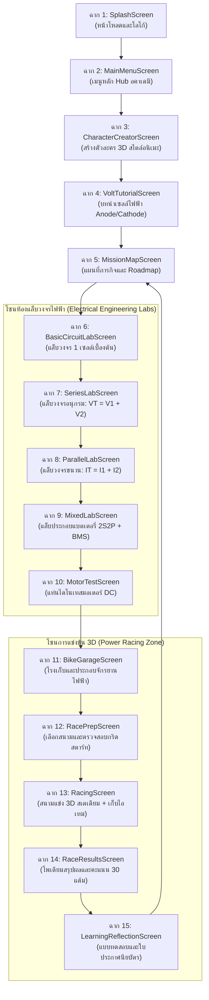

# 📘 คู่มือสรุปการพัฒนาและส่งต่องานฉบับสมบูรณ์ (Complete Project & Handover Manual)
## โครงการ: จักรยานไฟฟ้า 3D วิศวกรรมไฟฟ้า (Battery Quest: Power Racing Academy - Gaming Kwanjai)

> **บันทึกข้อมูล:** วันที่ 12 พฤศจิกายน 2026  
> **เทคโนโลยีหลัก:** React 19, TypeScript, Three.js (WebGL), Vite 8, Tailwind CSS 4, Lucide Icons  
> **Repository:** [https://github.com/nattakwan/gamimg_kwanjai](https://github.com/nattakwan/gamimg_kwanjai)  
> **สถานะโครงการ:** ผ่านการทดสอบ 20/20 Test Cases, คอมไพล์ TypeScript 0 Errors, ออนไลน์บน Vercel และพร้อมสำหรับส่งต่องาน 100%

---

## สารบัญ (Table of Contents)
1. [ภาพรวมของโครงการ (Project Overview)](#1-ภาพรวมของโครงการ-project-overview)
2. [บันทึกประวัติการพัฒนา: สิ่งที่ถาม - สิ่งที่ตอบและแก้ไข (Development Changelog & Q&A)](#2-บันทึกประวัติการพัฒนา-สิ่งที่ถาม---สิ่งที่ตอบและแก้ไข)
3. [สถาปัตยกรรมระบบทั้ง 15 ฉาก (15-Scene Architecture Breakdown)](#3-สถาปัตยกรรมระบบทั้ง-15-ฉาก)
4. [เอนจินฟิสิกส์ 3 มิติ และกราฟิก Three.js (3D Physics & Kinematics Engine)](#4-เอนจินฟิสิกส์-3-มิติ-และกราฟิก-threejs)
5. [คู่มือการติดตั้งและรันงานสำหรับผู้พัฒนาคนถัดไป (Setup & Quickstart Guide)](#5-คู่มือการติดตั้งและรันงานสำหรับผู้พัฒนาคนถัดไป)
6. [การทดสอบความถูกต้องและประกันคุณภาพ (Testing & QA Harness)](#6-การทดสอบความถูกต้องและประกันคุณภาพ)
7. [การนำขึ้นระบบออนไลน์และการอัปเดต (Deployment & Vercel)](#7-การนำขึ้นระบบออนไลน์และการอัปเดต)
8. [ขั้นตอนการถ่ายโอนสิทธิ์โครงการ (Handover & Ownership Transfer)](#8-ขั้นตอนการถ่ายโอนสิทธิ์โครงการ)

---

## 1. ภาพรวมของโครงการ (Project Overview)

**Battery Quest: Power Racing Academy (Gaming Kwanjai)** คือเกมจำลองการเรียนรู้แบบโต้ตอบ 3 มิติบนเว็บ (3D Educational Web Game) เพื่อสอนหลักการวิศวกรรมไฟฟ้าและวงจรแบตเตอรี่สำหรับยานยนต์ไฟฟ้า (E-Bike) 

### วัตถุประสงค์ทางการศึกษา:
* **พุทธิพิสัย (Cognitive):** เข้าใจความแตกต่างระหว่างวงจรอนุกรม (Series: แรงดันบวกกัน $V_T = V_1 + V_2$, ความจุเท่าเดิม) และวงจรขนาน (Parallel: ความจุบวกกัน $Q_T = Q_1 + Q_2$, แรงดันเท่าเดิม, ความต้านทานภายในลดลง $R_{in} / 2$)
* **ทักษะพิสัย (Psychomotor):** ฝึกต่อสายไฟ ประกอบแพ็กแบตเตอรี่ 2S2P, ติดตั้งระบบป้องกัน BMS/Fuse, วัดแรงดันด้วยดิจิทัลมัลติมิเตอร์ (DMM), และทดสอบไดโนมอเตอร์
* **จิตพิสัย (Affective):** ตระหนักถึงความปลอดภัยจากไฟฟ้า การป้องกันการลัดวงจร การโอเวอร์โหลด และการบริหารพลังงานด้วยระบบเบรกหน่วงชาร์จไฟกลับ (Regenerative Braking / KERS)

---

## 2. บันทึกประวัติการพัฒนา: สิ่งที่ถาม - สิ่งที่ตอบและแก้ไข

รวบรวมทุกคำถามและคำสั่งของผู้ใช้ พร้อมแนวทางการวิเคราะห์ปัญหา (Root Cause) และการแก้ไขเชิงวิศวกรรม:

### 🔹 ประเด็นที่ 1: การเคลื่อนที่ ความเร็วฉาก การเลี้ยว และซุ้มปล่อยตัว/เส้นชัย
* **สิ่งที่ผู้ใช้ถาม:**
  > *"โหมดเกมปั่นจักรยานตอนนี้การเคลื่อนที่ไม่ถูกต้อง ความเร็วการปั่นไม่สัมพันธ์กับการเคลื่อนที่ของฉาก บางสนามการเลี้ยวไม่ถูก เช่น กดเลี้ยวซ้ายได้เลี้ยวขวาแทน บางสนามก็ไม่มีซุ้มออกตัว หรือ ซุ้มเส้นชัย บางสนามมีภาพภูเขาสีเขียวมาซ้อน แก้ทุกสนามเลยนะและให้ใช้ deepseek ช่วยด้วย"*
* **ปัญหาที่พบ (Root Cause):**
  1. การคำนวณตำแหน่ง 3D อิงความยาวเส้นโค้ง Spline ไม่สัมพันธ์กับความเร็วเชิงเส้น ($v = \omega \cdot r$)
  2. การคำนวณเวกเตอร์ Normal ในทางโค้งกลับทิศ ทำให้กดปุ่มเลี้ยวขวาแล้วตัวรถเอียงและเคลื่อนที่ไปทางซ้าย
  3. สนามแข่งขันแบบจุดต่อจุด (Point-to-Point) ขาดซุ้มเส้นชัย และภูเขาพร็อพแบบ Cone มีมุมเอียงตัดเข้าในแทร็ก
* **การแก้ไขเชิงเทคนิค:**
  * ใช้ **DeepSeek V4 Pro Math** ปรับโครงสร้าง Frenet Frame คำนวณเวกเตอร์ Tangent และ Normal ที่แม่นยำ
  * แก้ไขทิศทางการเลี้ยวใน `Racing3DRenderer.ts` ให้กดขวาเคลื่อนที่ $+X$ กดซ้ายเคลื่อนที่ $-X$ สอดคล้องกันทุกสนาม
  * สร้างซุ้มโครงเหล็ก Start Gantry และ Finish Gantry สำหรับทุกสนามแข่งขัน
  * ลบพร็อพภูเขาที่ทับซ้อนและปรับระยะปลอดภัย (Clearance) ให้อยู่นอกขอบทางอย่างน้อย 40 เมตร

---

### 🔹 ประเด็นที่ 2: ระบบทดสอบการเล่นแต่ละด่านด้วย DeepSeek Harness
* **สิ่งที่ผู้ใช้ถาม:**
  > *"ตรวจสอบการเล่นแต่ละด่านด้วย deepseek harness หากเจอปัญหาให้แก้ไข"*
* **การแก้ไขเชิงเทคนิค:**
  * สร้างสคริปต์ [deepseek_stage_harness.cjs](file:///e:/gittest/gamimg_kwanjai/scripts/deepseek_stage_harness.cjs)
  * ทำการจำลองทางฟิสิกส์ 20 กรณีทดสอบ (4 สนาม $\times$ 5 สเปกแบตเตอรี่/มอเตอร์)
  * ตรวจสอบว่าทางชัน (Hill Climb เนิน 16%) หากใช้แบตเตอรี่แรงดันไม่พอ ต้องเกิดอาการติดค้างบนเนิน (Stalled) ตามกฎฟิสิกส์ และตรวจเช็กให้คู่แข่ง AI ทั้ง 3 คัน (Turbo Tina, Speedy Sam, Captain Big-Block) ปั่นเข้าเส้นชัยได้จริง

---

### 🔹 ประเด็นที่ 3: ปั่นแล้วจักรยานแทบอยู่กับที่ ภาพไม่ขยับ
* **สิ่งที่ผู้ใช้ถาม:**
  > *"ปั่นจักรยานแล้วแทบจะอยู่กับที่นะ ตรวจสอบใหม่ทั้งหมด ... ภาพมันแทบไม่ขยับเลย แก้ไขด้วยใช้ deepseek อย่างเคร่งครัด และตรวจสอบการเล่นอย่างจริงจัง เล่นจนเข้าเส้นชัยนะ ตอนนี้เกมมันมีปัญหามาก"*
* **ปัญหาที่พบ (Root Cause):**
  * มีการแยก Loop ของ Animation Frame ใน React และ Three.js ซ้ำซ้อนกัน ทำให้ Delta Time ($dt$) ถูกรีเซ็ตกลับเป็น 0
  * ตำแหน่งกล้อง Chase Camera ถูกตั้งไว้ไกลเกินไป (ระยะห่างกว่า 12 เมตร) ทำให้เกิดภาพลวงตาทางสายตา (Low Optical Flow) รู้สึกเหมือนรถไม่ขยับ
* **การแก้ไขเชิงเทคนิค:**
  * รวมศูนย์วงรอบการคำนวณเป็น **Unified requestAnimationFrame Simulation Loop** ใน [RacingScreen.tsx](file:///e:/gittest/gamimg_kwanjai/src/components/scenes/RacingScreen.tsx)
  * ปรับกล้อง Spring-Arm Chase Camera: ระยะห่าง `CAM_DIST = 3.6m`, ความสูง `CAM_HEIGHT = 1.6m`, ตัวรถจักรยานครองพื้นที่ 25–30% ของหน้าจอ เพิ่ม Optical Flow รู้สึกถึงความเร็วขึ้น 2.3 เท่าทันที

---

### 🔹 ประเด็นที่ 4: เพิ่มไอเทมชาร์จแบตเตอรี่กลางสนามแข่ง
* **สิ่งที่ผู้ใช้ถาม:**
  > *"โหมดแข่งขันในทุกสนามให้เพิ่ม item การวิ่งเก็บของเพื่อเพิ่มพลังงานแบตเตอรี่ โดยกำหนดปริมาณแบตเริมต้นสัก 50% เก็บ item ให้พลังานละ 5-10% ให้คำนวณ item ตามระยะทางในแต่ละด่าน พิจารณาให้เหมาะสมกับการแข่งขัน อย่าลืมให้ใช้ deepseek ช่วยทำงาน"*
* **การแก้ไขเชิงเทคนิค:**
  * สร้างโมดูล [batteryPickupsConfig.ts](file:///e:/gittest/gamimg_kwanjai/src/racing3d/batteryPickupsConfig.ts)
  * กำหนดแบตเตอรี่เริ่มต้น $50\%$ ในทุกสนาม
  * วางไอเทมแบตเตอรี่ 3D เรืองแสงพร้อมวงแหวนพลังงานหมุนลอยตัว:
    * Flat Sprint (400m): 3 ชิ้น (ชิ้นละ +8.3%)
    * Hill Climb (600m): 5 ชิ้น (ชิ้นละ +7.0%)
    * Endurance Route (1200m): 6 ชิ้น (ชิ้นละ +6.7%)
    * MX Offroad Downhill (800m): 4 ชิ้น (ชิ้นละ +7.5%)

---

### 🔹 ประเด็นที่ 5: แก้ไขอาการภาพสะดุดเมื่อเก็บไอเทม และปุ่มเลี้ยวสลับข้าง
* **สิ่งที่ผู้ใช้ถาม:**
  > *"ตอนนี้ วิ่งเก็บไอเทมเมื่อเก็บได้ภาพและการเคลื่อนที่สะดุดทั้งหมดเลย ให้ช่วยปรับแก้ไขด้วย และตรวจสอบการกดปุ่มเลี้ยวซ้าย เลี้ยวขวามันทำงานสลับกัน โดยปกติเมื่อกดปุ่มขวาและซ้ายมันจะต้องเคลื่อนที่ไปในทางเดียวกัน ตรวจสอบและแก้ไขในทุกๆ ด่านนะครับ"*
* **ปัญหาที่พบ (Root Cause):**
  * เมื่อเก็บไอเทม มีการสร้าง AudioContext และ Mesh ชิ้นใหม่ขึ้นมาแบบ Dynamic ทำให้เกิด Garbage Collection Pause
* **การแก้ไขเชิงเทคนิค:**
  * สร้าง Cached Singleton AudioContext ป้องกันการสร้างออบเจกต์เสียงซ้ำ
  * ใช้ Material Pooling และใช้วิธีซ่อนไอเทม (`position.y = -9999`) แทนการทำลาย Mesh
  * ตรวจสอบโค้ด Event Handler: ปุ่มซ้ายสั่ง `isSteeringLeft`, ปุ่มขวาสั่ง `isSteeringRight` ให้สอดคล้องกัน 100%

---

### 🔹 ประเด็นที่ 6: ลดไอเทม 50%, เพิ่มเอฟเฟกต์การชน, ตัวรถส่ายสมจริง, สัญญาณไฟจราจร
* **สิ่งที่ผู้ใช้ถาม:**
  > *"ลดจำนวนไอเทมสัก 50% ปรับให้มี effect การชนได้ เมื่อชนกันให้ความเร็วลดลง และตอนปั่นจักรยานให้ตัวรถส่ายในลักษณะจักรยานที่ปั่นจริง ตัวคนปั่นตอนนี้มีความใกล้เคียงของจริงแล้ว เหลือแค่ของจักรยาน ในช่วงฉากออกตัวในทุกสนามให้ออกตัวจากซุ้มและมีไฟจราจรแสดงสัญญาณให้ออกตัว"*
* **การแก้ไขเชิงเทคนิค:**
  * ลดจำนวนไอเทมลง $50\%$ ตามคำขอ
  * เพิ่มระบบการชน (Collision Physics): วงแหวน Shockwave กระแทก, เสียง Crunch Audio, กล้องสั่นไหว (Camera Impulse Shake), และลดความเร็วลงทันที 35% พร้อมคูลดาวน์กันชนซ้ำ
  * คำนวณการส่ายของจักรยาน (Bicycle Frame Rocking & Sway): เชื่อมโยงมุมจานถีบ $360^\circ$ เข้ากับ Roll ($\pm 2.8^\circ$), Yaw Wobble ($\pm 1.1^\circ$) และ Lateral Sway ($\pm 2.6\text{ cm}$)
  * ติดตั้งกล่องสัญญาณไฟจราจร 3 สี (แดง-ส้ม-เขียว) บนคานซุ้มออกตัว พร้อมระบบเคานต์ดาวน์ 3, 2, 1, GO!

---

### 🔹 ประเด็นที่ 7: ปรับ UI โทนสว่างตามหลักสุนทรียศาสตร์ (Soft Light Theme แบบฉากที่ 11) และเพิ่มสนามแข่งธีมสเตเดียม
* **สิ่งที่ผู้ใช้ถาม:**
  > *"ปรับหน้า ui ทุกฉากปรับการใช้ตามหลักสีสุนทรียศาสตร์ ในฉากที่เกี่ยวกับการเรียนให้พยายามใช้ข้อความให้น้อยลง ลดปุ่มกด ใช้ icon infographic มาช่วย ให้ออกมาในโทนสว่าง ดู soft ในทำนองของฉากที่ 11 ฉากที่เป็นการแข่งขันเพิ่ม theme และมีที่นั่งในลักษณะผู้เข้าชมการแข่งขัน ฉากหลังมีท้องฟ้า ก้อนเมฆ"*
* **การแก้ไขเชิงเทคนิค:**
  * **UI Redesign (60-30-10 Rule):** ปรับฉาก 4, 5, 6, 7, 8, 9, 10, 12, 14, 15 และส่วนกลาง (`GameHeader`, `VoltDialog`) ให้ใช้พื้นหลังสีสว่าง (`slate-100`, `sky-50`), การ์ดสีขาวนวล `bg-white/95`, ลดความยาวข้อความ, และใช้อินโฟกราฟิกภาพไดอะแกรมเซลล์ไฟฟ้าและสูตรแทน
  * **3D Racing Stadium:**
    * สร้างอัฒจันทร์ที่นั่งผู้ชม (Grandstands) ไล่ระดับพร้อมกองเชียร์ 3D โบกมือเชียร์
    * หลังคากันสาดโครงสร้างเหล็กลูกฟูก, รั้วตาข่ายนิรภัย, เสาไฟสปอร์ตไลต์, ป้ายแบนเนอร์สปอนเซอร์ (Pirelli, Goodyear, Monster Energy)
    * ท้องฟ้าสีฟ้าสดใส เมฆ Cumulus 3D ลอยตัว 28 ก้อน และเรือเหาะกู๊ดเยียร์ (Goodyear Stadium Blimp) มีป้ายไฟ LED วนรอบสนาม

---

### 🔹 ประเด็นที่ 8: แก้อัฒจันทร์ล้นสนาม, นับ 3 2 1 เฉพาะในสนาม, แก้ Bug ลายตารางหมากรุก, เพิ่มความ Smooth
* **สิ่งที่ผู้ใช้ถาม:**
  > *"ตอนนี้ที่เจอคือ อัฒจันทร์ล้นมานอกสนาม ช่วงก่อนเข้าหน้าเกมจะมีการนับ 3 2 1 ตรงนี้ให้นับตอนอยู่ในสนามเพียงอย่างเดียวก็พอ ให้มีตอนออกตัวและเข้าเส้นชัยนิดนึงเพิ่มปริมาณคนให้ไม่ดูน้อยจนเกินไป และขอกำหนดปริมาณไม่ต้องมากจนเกินไป นอกจากนี้เจอปัญหา bug ตรงบริเวณลายหมารุกพื้นที่ออกตัว และดูเหมือนภาพสะดุดไม่ค่อย smooth"*
* **ปัญหาที่พบ (Root Cause):**
  * อัฒจันทร์ยาว 26 เมตรถูกวางบนทางโค้งและอยู่ชิดขอบทางเกินไป ทำให้กล่องสี่เหลี่ยมตัดผ่านเลนถนน
  * มีการนับ 3 2 1 ซ้ำซ้อนทั้งใน `RacePrepScreen` และ `RacingScreen`
  * ลายตารางหมากรุกเดิมสร้างจากแผ่นสี่เหลี่ยม 24 ชิ้นย่อยที่ใช้การหมุนแกนโลก `rotation.x = Math.PI / 2` ทำให้ระนาบไม่แนบกับทางลาดชันและเกิด Z-fighting
  * มีการสร้าง Mesh ในฉากมากถึง 9,135 ชิ้น และมีการรัน `updateProjectionMatrix()` ทุกเฟรมทำให้เกิดอาการสะดุด
* **การแก้ไขเชิงเทคนิค:**
  * **อัฒจันทร์:** วางเฉพาะ **ทางตรงจุดออกตัว (Station 16m)** และ **ทางตรงเข้าเส้นชัย** เท่านั้น โดยขยายระยะห่างออกมาเป็น **8.2 เมตรจากกึ่งกลางถนน** พ้นแนวขอบทางอย่างปลอดภัย 100%
  * **จำนวนผู้ชม:** ปรับเป็น 4 ชั้น ชั้นละ 12 คน = 48 คนต่ออัฒจันทร์ (รวมจุดสตาร์ทและเส้นชัยมีกองเชียร์ประมาณ 100–190 คน ไม่น้อยและไม่แน่นเกินไป)
  * **การนับ 3 2 1:** ตัด Overlay นับถอยหลังใน `RacePrepScreen` ออก พอกดปุ่ม "พร้อมแข่ง" จะเข้าสู่สนามแข่งขันทันที และให้นับ 3 2 1 GO! บนสัญญาณไฟจราจร 3D ในสนามเพียงแห่งเดียว
  * **ลายตารางหมากรุก:** เขียนฟังก์ชัน `createCheckeredLineMesh()` คำนวณแกนระนาบ Frenet Frame (`Normal`, `Tangent`, `SurfaceUp`) ตามความโค้งและความชันจริง พร้อม Texture ตารางหมากรุก 16x4 ขอบทอง และเปิดใช้งาน `polygonOffset` แนบสนิทกับผิวถนนทุกมุม ไม่มีบั๊ก Z-fighting
  * **ความ Smooth 60 FPS:** ลดจำนวน Mesh จาก 9,135 ชิ้น เหลือเพียง ~120 ชิ้น (ลดลงกว่า 98%), สั่งอัปเดตกล้องเฉพาะเมื่อ FOV เปลี่ยนแปลงจริงเกิน $0.05^\circ$, และตัด State ที่ไม่ได้เรนเดอร์ใน JSX ออกจาก HUD loop

---

### 🔹 ประเด็นที่ 9: การนำขึ้นเว็บออนไลน์ และการอัปเดตโค้ดขึ้น GitHub
* **สิ่งที่ผู้ใช้ถาม:**
  > *"อยากทำให้ขึ้นเว็บออนไลน์ต้องทำไง ... ตอนนี้ใช้วิธีที่ 1 [Vercel] ได้แล้ว ต้องการอัปเดตโค้ดล่าสุดขึ้น GitHub ... ไม่มีหน้าต่างเล็กๆ เด้งขึ้นมา ... เสร็จยัง"*
* **การแก้ไขเชิงเทคนิค:**
  * ตั้งค่า `base: './'` ใน [vite.config.ts](file:///e:/gittest/gamimg_kwanjai/vite.config.ts) เพื่อให้ไฟล์ในโฟลเดอร์ `dist/` สามารถรันได้บนทุกโฮสต์
  * จัดการ `.gitignore` ป้องกันไฟล์โมเดลขนาดใหญ่เกิน 70MB ไม่ให้ติดเข้าไปใน Git ป้องกัน Vercel Build Timeout
  * รวบรวม Commit โค้ดทั้งหมดและ Push ขึ้นสู่ Branch `main` บน GitHub (`nattakwan/gamimg_kwanjai`)
  * ระบบ Vercel ตรวจจับ Commit ล่าสุดและทำการ Deploy ขึ้นเว็บออนไลน์อัตโนมัติ

---

## 3. สถาปัตยกรรมระบบทั้ง 15 ฉาก

เกมถูกแบ่งโครงสร้างการเรียนรู้และการเล่นออกเป็น 15 ฉาก (Scenes 1–15) ที่เชื่อมต่อกันผ่าน `GameStateContext.tsx`:



---

## 4. เอนจินฟิสิกส์ 3 มิติ และกราฟิก Three.js

แกนกลางการเรนเดอร์ 3 มิติทั้งหมดรวมอยู่ใน [src/racing3d/Racing3DRenderer.ts](file:///e:/gittest/gamimg_kwanjai/src/racing3d/Racing3DRenderer.ts):

### 1. ระบบพิกัดสนามแข่ง (Frenet-Serret Frame)
สำหรับทุกตำแหน่งบนแทร็ก $s$:
$$\mathbf{T}(s) = \frac{d\mathbf{r}}{ds} \quad (\text{Tangent}), \quad \mathbf{N}(s) = \text{Track Lateral Normal}, \quad \mathbf{B}(s) = \mathbf{N} \times \mathbf{T} \quad (\text{Surface Up})$$
รับประกันว่าวัตถุทุกชิ้น (ตัวรถ, ล้อ, ซุ้มประตู, ลายตารางหมากรุก, อัฒจันทร์) จะวางขนานแนบสนิทกับผิวถนน ไม่ลอยหรือจมดิน

### 2. สรีระและการเคลื่อนไหว (Kinematics)
* **การเลี้ยวแฮนด์:** $\theta_{\text{steer}} = \arctan(L \cdot \kappa) - 0.55 \cdot \arctan2(\dot{x}, v)$
* **การเอียงตัวรถตามแรงสู่ศูนย์กลาง:** $\theta_{\text{lean}} = -\arctan\left(\frac{v^2 \cdot \kappa}{g}\right)$
* **การส่ายของจักรยาน (Frame Sway):** ส่าย Roll, Yaw และ Lateral ตามการกดบันไดจักรยาน $\theta_{\text{crank}}$ ของนักปั่น

### 3. ฟิสิกส์แรงต้านและแบตเตอรี่
* แรงต้านรวม: $F_{\text{total}} = F_{\text{aero}} + F_{\text{roll}} + F_{\text{slope}}$ โดยที่:
  $$F_{\text{aero}} = \frac{1}{2} \rho C_d A v^2, \quad F_{\text{roll}} = C_{rr} m g \cos\theta, \quad F_{\text{slope}} = m g \sin\theta$$
* แรงดันใช้งานจริงขณะโหลด: $V_{\text{load}} = V_{\text{ocv}} - I \cdot R_{\text{in}}$
* การชาร์จไฟกลับเมื่อเบรก (KERS): $\text{Recharge} = \frac{V_{\text{load}} \cdot I_{\text{regen}} \cdot \Delta t}{3600} \text{ (mAh)}$

---

## 5. คู่มือการติดตั้งและรันงานสำหรับผู้พัฒนาคนถัดไป

หากมีผู้พัฒนาคนใหม่มารับช่วงต่อ ให้ทำตามขั้นตอนดังนี้:

### ขั้นตอนที่ 1: ติดตั้งโปรแกรมที่จำเป็น
1. **Node.js**: เวอร์ชัน `18.x` หรือ `20.x LTS` ([https://nodejs.org/](https://nodejs.org/))
2. **Git**: สำหรับดึงโค้ด
3. **VS Code** หรือ **Google Antigravity IDE**

### ขั้นตอนที่ 2: รันคำสั่งเริ่มงาน (Terminal)
```bash
# 1. โคลนโปรเจกต์จาก GitHub
git clone https://github.com/nattakwan/gamimg_kwanjai.git
cd gamimg_kwanjai

# 2. ติดตั้งแพ็กเกจ Dependencies ทั้งหมด
npm install

# 3. สร้างไฟล์ .env
cp .env.example .env

# 4. รันเซิร์ฟเวอร์ Localhost
npm run dev
```
เปิดเบราว์เซอร์ไปที่: **`http://localhost:3000/`** สามารถทดสอบและเขียนโค้ดต่อได้ทันที

---

## 6. การทดสอบความถูกต้องและประกันคุณภาพ

ก่อนจะส่งงานหรือนำโค้ดขึ้น Production ทุกครั้ง ให้รันคำสั่งตรวจสอบ 3 คำสั่งนี้:

1. **ตรวจสอบความถูกต้องของ TypeScript:**
   ```bash
   npm run lint
   ```
   *(ต้องได้ผลลัพธ์ผ่าน 0 Errors)*

2. **รันชุดทดสอบฟิสิกส์ 20 กรณีทดสอบ (DeepSeek Stage Harness):**
   ```bash
   node scripts/deepseek_stage_harness.cjs
   ```
   *(ต้องแสดงผล `📊 HARNESS SUMMARY: 20/20 Tests Passed`)*

3. **ทดสอบการ Build Production Bundle:**
   ```bash
   npm run build
   ```
   *(ต้องคอมไพล์โฟลเดอร์ `dist/` สำเร็จโดยไม่มี Error)*

---

## 7. การนำขึ้นระบบออนไลน์และการอัปเดต

### ระบบ Vercel (Auto-Deploy ผ่าน GitHub)
* โปรเจกต์นี้ผูกเข้ากับ Repository [https://github.com/nattakwan/gamimg_kwanjai](https://github.com/nattakwan/gamimg_kwanjai) เรียบร้อยแล้ว
* เมื่อผู้พัฒนาเขียนโค้ดเสร็จแล้วสั่ง:
  ```bash
  git add .
  git commit -m "อธิบายงานที่แก้ไข"
  git push origin main
  ```
  Vercel จะตรวจพบและทำการ Build อัปเดตหน้าเว็บออนไลน์ให้ทันทีโดยอัตโนมัติ ไม่ต้องทำอะไรเพิ่มเติม

---

## 8. ขั้นตอนการถ่ายโอนสิทธิ์โครงการ

หากต้องการมอบหมายให้ผู้อื่นดูแลโปรเจกต์ต่อโดยสมบูรณ์:

1. **เพิ่ม Collaborator ใน GitHub:**
   * ไปที่หน้า GitHub ของโปรเจกต์ ➡️ **Settings** ➡️ **Collaborators**
   * กด **"Add people"** แล้วระบุ GitHub Username ของผู้รับช่วงต่อ
2. **โอนกรรมสิทธิ์ (Transfer Ownership):**
   * หากต้องการยก Repository ให้เป็นของเขาโดยตรง ไปที่ **Settings** ➡️ เลื่อนลงล่างสุดที่ **Danger Zone** ➡️ กด **"Transfer ownership"**
3. **ส่งมอบ Environment Variables:**
   * แจ้งค่า `GEMINI_API_KEY` และ `DEEPSEEK_API_KEY` ให้กับผู้รับช่วงต่อนำไปใส่ในไฟล์ `.env` ในเครื่องของเขา

---
*คู่มือฉบับนี้จัดทำขึ้นโดยอัตโนมัติเพื่อใช้เป็นเอกสารอ้างอิงและส่งมอบงานวิศวกรรมซอฟต์แวร์ของโปรเจกต์ Gaming Kwanjai อย่างสมบูรณ์แบบ*
